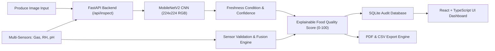

# FoodQualityAI: AI-Powered Smart Food Quality & Freshness Detection System

FoodQualityAI is an end-to-end industrial software system designed to automate agricultural produce inspection. It fuses deep computer-vision surface classification (MobileNetV2 CNN) with environmental sensor telemetry (gas VOC emissions, relative humidity, and pH levels) into an explainable, audit-ready **Food Quality Score** (0–100) and commercial grade (Grades A through D).

---

## 1. System Architecture



### Technology Stack
- **Frontend**: React 18, TypeScript, Vite, Lucide Icons, pure accessible CSS styling (light theme with forest green accents).
- **Backend**: Python 3.11, FastAPI, Uvicorn, SQLite3, ReportLab (PDF generator), Pydantic.
- **Machine Learning**: PyTorch 2.x, Torchvision, Scikit-learn, Pillow, MobileNetV2 architecture.
- **Data Integrity**: Stratified train/val/test splits without duplicating raw dataset files.

---

## 2. Dataset Overview & Real Audit Results

The system was audited on the local dataset located in `data/`:

- **Total Images Detected**: 14,682
- **Corrupted / Unreadable Images**: 0 (100% header verified)
- **Exact Duplicates**: 0
- **Total Produce Categories**: 6 (Apple, Banana, Bitter Gourd, Capsicum, Orange, Tomato)
- **Total Fine-Grained Classes**: 12
  - `fresh_apple` (1,693), `stale_apple` (2,342)
  - `fresh_banana` (1,581), `stale_banana` (1,467)
  - `fresh_bitter_gourd` (327), `stale_bitter_gourd` (357)
  - `fresh_capsicum` (990), `stale_capsicum` (901)
  - `fresh_orange` (1,466), `stale_orange` (1,595)
  - `fresh_tomato` (981), `stale_tomato` (982)

---

## 3. Scientific Distinction & Food Safety Disclaimer

> [!IMPORTANT]
> **Surface Freshness vs. Chemical Adulteration:**
> Image-based freshness classification detects visible exterior senescence, bruising, dehydration wrinkles, and fungal rot patches. **A photograph alone CANNOT prove or disprove chemical adulteration** (e.g. formalin, calcium carbide, synthetic dye dips) or microbial pathogens (e.g. *Salmonella*, *E. coli*). For regulatory safety confirmation, chemical assays or spectroscopy are mandatory.

---

## 4. Quickstart Guide (Windows PowerShell)

Follow these exact steps from the project root directory `d:\FoodQualityAi`:

### Step 1: Set Up Python Virtual Environment
```powershell
# Create venv with Python 3.11
py -3.11 -m venv venv

# Activate virtual environment
.\venv\Scripts\Activate.ps1

# Upgrade pip
python -m pip install --upgrade pip

# Install dependencies
python -m pip install torch torchvision --index-url https://download.pytorch.org/whl/cpu
python -m pip install fastapi "uvicorn[standard]" python-multipart pydantic scikit-learn pandas matplotlib reportlab pytest httpx requests
```

### Step 2: Audit Dataset & Prepare Stratified Splits
```powershell
# Audit all 14,682 images for integrity, formats, and corruptions
python scripts\audit_dataset.py

# Create reproducible 80/10/10 train/val/test splits
python scripts\prepare_dataset.py
```

### Step 3: Run Model Training & Evaluation
```powershell
# Smoke-test mode (rapid pipeline verification with 20 samples per class)
python scripts\train_model.py --smoke-test --epochs 2 --batch-size 16

# Full training mode (optional for high accuracy on full dataset)
# python scripts\train_model.py --epochs 5 --batch-size 32

# Evaluate model on the held-out test split
python scripts\evaluate_model.py --max-samples 100

# Test single image prediction from CLI
python scripts\predict_image.py "data\fresh_apple\rotated_by_15_Screen Shot 2018-06-08 at 4.59.36 PM.png"
```

### Step 4: Run Automated Backend Tests
```powershell
$env:PYTHONPATH="."
.\venv\Scripts\pytest tests\test_backend.py
```
*(All 10 test cases covering health, model loading, image inspection, validation, sensor simulation, history, CSV export, and PDF generation pass).*

### Step 5: Start Backend and Frontend Servers

**Terminal 1 — Backend:**
```powershell
.\venv\Scripts\Activate.ps1
$env:PYTHONPATH="."
python -m uvicorn backend.app.main:app --host 127.0.0.1 --port 8000 --reload
```
API Documentation will be live at: `http://127.0.0.1:8000/docs`

**Terminal 2 — Frontend:**
```powershell
cd frontend
npm install
npm run dev
```
Open your browser at `http://localhost:5173`.

---

## 5. Key Endpoints

| Method | Endpoint | Purpose |
|---|---|---|
| `GET` | `/api/health` | Healthcheck and model readiness |
| `GET` | `/api/model-status` | Model weights, device, and class mappings |
| `POST` | `/api/inspect` | Single produce image inspection + sensor fusion |
| `POST` | `/api/batch-inspect` | Concurrently inspect up to 50 images |
| `GET` | `/api/dashboard-stats` | Real SQLite aggregations for freshness & grades |
| `GET` | `/api/inspections` | Query history with filtering & search |
| `GET` | `/api/export/csv` | Download complete audit spreadsheet |
| `GET` | `/api/export/pdf/{id}`| Generate certified audit PDF report |

---

## 6. Project Demonstration Walkthrough

1. **Overview & Problem Statement**: Demonstrate the landing page explaining the system architecture and the scientific distinction between surface freshness and chemical adulteration.
2. **Execute Single Inspection**: Upload a produce image (e.g. from `data/fresh_apple` or `data/stale_banana`). Choose simulated sensor mode or type physical sensor readings. Observe the predicted class, confidence, grade, and quality score.
3. **Download PDF Report**: Click "Download Certified Audit PDF" to demonstrate real ReportLab PDF generation.
4. **Batch Processing**: Navigate to "Batch", select multiple produce images, and process them in bulk.
5. **Dashboard & History**: Inspect the live SQLite metrics updating dynamically without hardcoded counts.
